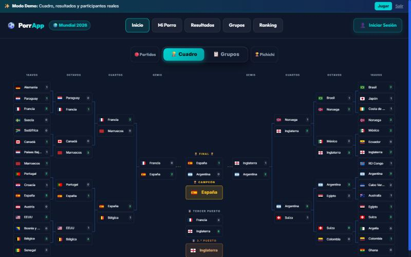
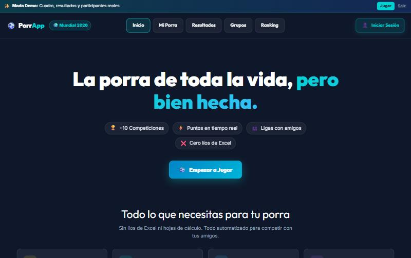
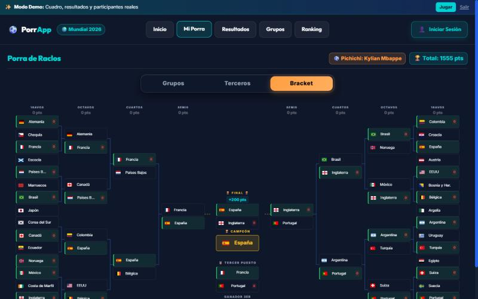

# PorrApp

[](https://github.com/RaclosDev/porrApp/actions/workflows/ci.yml)

Porras de fútbol con amigos: cada liga elige su formato, los resultados se sincronizan solos y la clasificación se actualiza en directo.

**Demo:** [porra.raclos.es/demo](https://porra.raclos.es/demo) (modo de solo lectura, sin registro)



| Portada | Pronóstico de un participante |
| --- | --- |
|  |  |

## Qué hace

- **Ligas privadas** con código de invitación, control de pagos y reglas propias por liga.
- **Tres formatos de porra**: cuadro completo (fase de grupos y eliminatorias), solo eliminatorias, o jornada a jornada con 1X2 y marcador exacto.
- **Resultados automáticos**: los partidos se sincronizan desde ESPN y la puntuación se recalcula en el backend.
- **Tiempo real**: los cambios de marcador llegan por WebSocket y refrescan clasificación, cuadro y jornadas.
- **Cuadro oficial en vivo**, con los cruces resueltos según la clasificación de grupos y los mejores terceros.
- **Inicio de sesión con Google** y sesión con JWT.
- **PWA** instalable en móvil.

## Stack

| Capa | Tecnologías |
| --- | --- |
| Frontend | React 19, TypeScript (`strict`), Vite, TanStack Query, Zustand, Tailwind CSS v4, Radix UI |
| Backend | Java 21, Spring Boot 4, Spring Security, Spring Data JPA, WebSockets, Resilience4j |
| Datos | PostgreSQL con migraciones Flyway |
| Calidad | Vitest + Testing Library, JUnit 5 + Mockito + Testcontainers, JaCoCo, ESLint, Prettier, GitHub Actions |
| Despliegue | Docker multi-etapa (el frontend se sirve desde Spring Boot) en Railway |

## Decisiones de diseño

- **Puntuación como estrategia.** `scoring/` separa las reglas (`ScoringRuleSet`) del cálculo (`ScoringStrategy`, con `WorldCup2026ScoringStrategy` como implementación), así que un torneo nuevo no toca el resto del dominio.
- **Resultados oficiales calculados, no introducidos.** `OfficialResultsService` monta el cuadro real (grupos, mejores terceros, cruces, podio y pichichi) a partir de los partidos sincronizados y la clasificación que se calcula con ellos; no hay una cuenta que tenga que mantenerlo a mano.
- **Proveedores de datos intercambiables.** `sports/` define `SportsDataProvider` y un registro; ESPN es la implementación actual y el resto del backend no sabe de dónde vienen los resultados.
- **Contrato tipado entre capas.** Los controladores devuelven DTOs/records y el frontend tiene un cliente único (`services/api.ts`) con los tipos de esas respuestas (`types/api.ts`).
- **Lógica fuera de los componentes.** Cálculos como el cuadro oficial, la normalización de pronósticos o la evolución de la clasificación son funciones puras en `utils/` y `components/*/…Data.ts`, con tests propios.
- **Esquema versionado.** Toda la base de datos sale de las migraciones Flyway y la validación está activa en el arranque.

Más detalle del backend en [docs/architecture.md](docs/architecture.md).

## Ejecutar en local

### Con Docker

```bash
cp .env.example .env   # rellena JWT_SECRET y GOOGLE_CLIENT_ID
docker compose up --build -d
```

La app queda en [http://localhost:8080](http://localhost:8080). `docker compose down -v` borra también la base de datos local.

### Por separado

Requisitos: Node.js 22, JDK 21 y PostgreSQL.

```bash
cd frontend
npm ci
npm run dev        # http://localhost:5173, con /api redirigido a localhost:8080
```

```bash
cd backend
./mvnw spring-boot:run   # en Windows: .\mvnw.cmd spring-boot:run
```

## Variables de entorno

| Variable | Uso |
| --- | --- |
| `POSTGRES_DB`, `POSTGRES_USER`, `POSTGRES_PASSWORD`, `POSTGRES_PORT` | Base de datos |
| `BACKEND_PORT` | Puerto de la aplicación |
| `JWT_SECRET` | Firma de los tokens (obligatoria, 32 bytes o más) |
| `GOOGLE_CLIENT_ID`, `VITE_GOOGLE_CLIENT_ID` | Inicio de sesión con Google |
| `CORS_ALLOWED_ORIGINS` | Orígenes permitidos |

La plantilla completa está en [`.env.example`](.env.example).

## Tests y CI

```bash
cd frontend && npm run lint && npm run test:coverage && npm run build
cd backend && ./mvnw -B test   # en Windows: .\mvnw.cmd -B test
```

`npm run lint` incluye la comprobación de tipos (`tsc --noEmit` en modo `strict`). En el backend, los tests de migraciones y el de arranque completo levantan un PostgreSQL real con Testcontainers (se saltan si no hay Docker). La cobertura queda en `frontend/coverage/` y `backend/target/site/jacoco/`.

El workflow de [GitHub Actions](.github/workflows/ci.yml) ejecuta lo mismo en cada PR y en cada push a `main`, pero solo los jobs de la parte que cambia (lo decide `.github/scripts/detect-changes.sh`): el frontend si cambia `frontend/`, el backend si cambia `backend/` y la imagen Docker si cambian el `Dockerfile` o los manifiestos de dependencias. Un cambio en la propia CI, la ejecución semanal y la manual lo pasan todo. La cobertura de las dos partes queda en el resumen de la ejecución. Railway solo despliega cuando la CI pasa.

## Estructura

```text
backend/src/main/java/com/porra/mundial/
  config/       seguridad y configuración
  controller/   endpoints REST y WebSocket
  dto/          contratos de la API
  model/        entidades JPA
  repository/   acceso a datos
  scoring/      reglas y estrategias de puntuación
  service/      lógica de negocio y sincronización
  sports/       proveedores de datos deportivos
backend/src/main/resources/db/migration/   migraciones Flyway

frontend/src/
  components/   UI, agrupada por área (groups, league, layout, prediction, evolution, official…)
  context/      datos compartidos de la sesión (TanStack Query)
  hooks/        lógica de cada pantalla
  pages/        rutas
  services/     cliente de la API
  store/        estado local persistente (Zustand)
  types/        tipos del contrato con el backend
  utils/        cálculos puros (cuadro, puntos, borradores)
```

## Licencia

[MIT](LICENSE)
