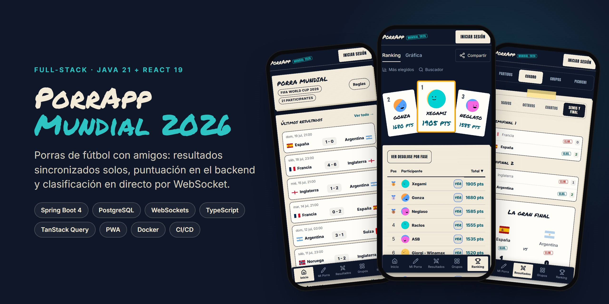
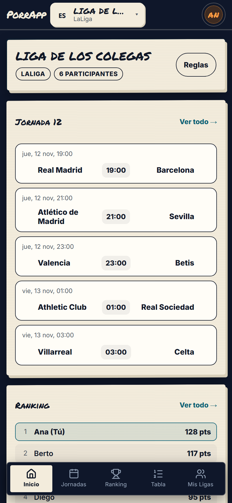
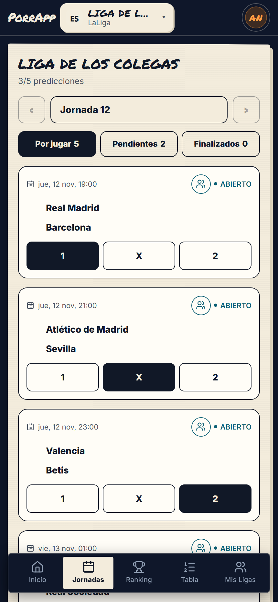
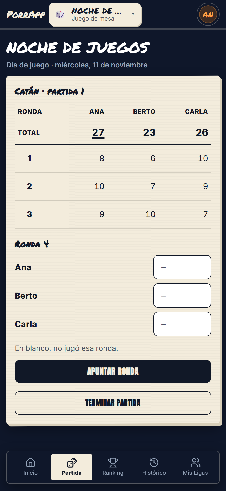
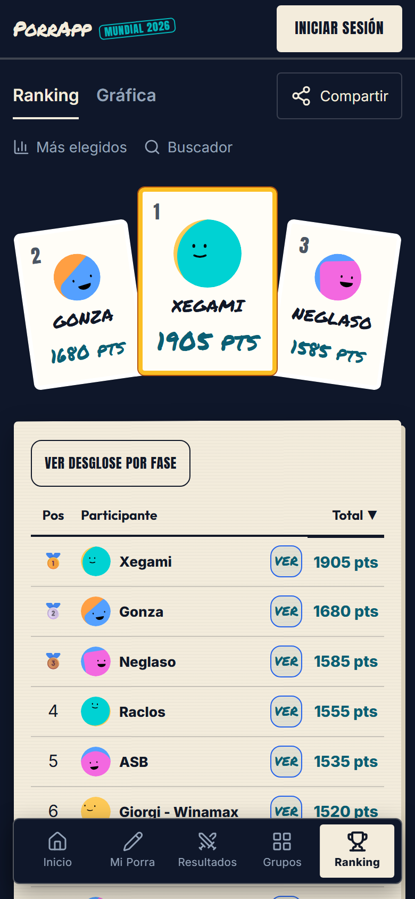
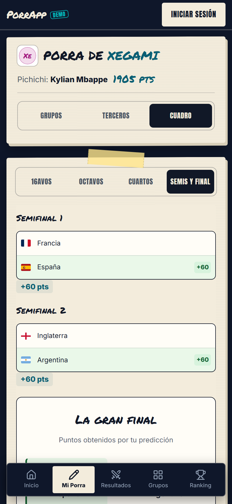
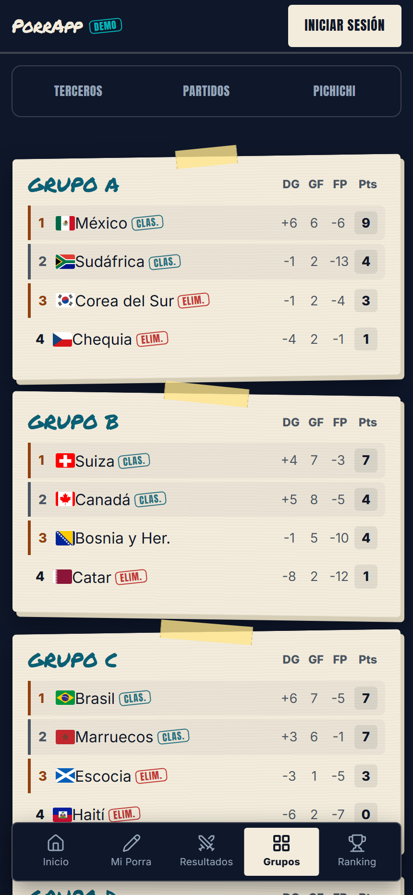
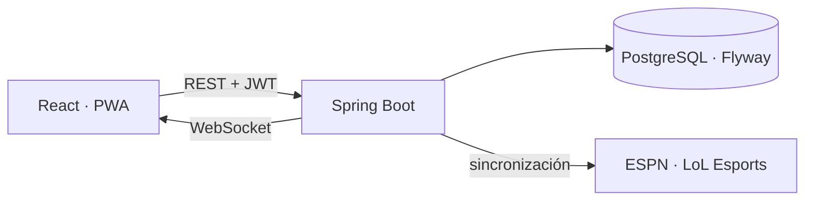

<div align="center">



# PorrApp

**Tu liga con amigos. Del pronóstico del domingo a la partida del jueves.**

Porras multideporte y marcadores de juegos de mesa, en una PWA con Java y React.

[](https://porrapp.app/demo)
[](https://github.com/RaclosDev/porrApp/actions/workflows/ci.yml)

Java 21 · Spring Boot 4.1 · React 19 · TypeScript · PostgreSQL

</div>

Proyecto personal de **Carlos Sanz Tomero**, desarrollador full-stack. PorrApp reúne invitaciones, predicciones, resultados y clasificación para que un grupo pueda llevar su liga desde el móvil. Las competiciones oficiales compatibles sincronizan sus resultados; los torneos propios y las partidas tienen gestión manual.

**Para conocer el proyecto:** [abre la demo sin registro](https://porrapp.app/demo), consulta las decisiones técnicas de abajo o entra en la [arquitectura](docs/architecture.md). La demo pública muestra una liga del Mundial en modo de solo lectura; las capturas también enseñan las modalidades incorporadas después.

## La app actual

<table>
  <tr>
    <td align="center" width="33%"><br><sub><b>Tu liga</b> · calendario y ranking</sub></td>
    <td align="center" width="33%"><br><sub><b>Jornadas</b> · cada partido tiene su cierre</sub></td>
    <td align="center" width="33%"><br><sub><b>Juegos de mesa</b> · rondas y partidas</sub></td>
  </tr>
  <tr>
    <td align="center"><br><sub><b>Ranking</b> · puntos y desglose</sub></td>
    <td align="center"><br><sub><b>Cuadro</b> · camino hasta la final</sub></td>
    <td align="center"><br><sub><b>Grupos</b> · clasificación y desempates</sub></td>
  </tr>
</table>

Capturas de la interfaz real, renovadas en noviembre de 2026. La primera fila usa datos ficticios en una ejecución local; la segunda procede de la demo pública. [Origen y reproducción de las capturas](docs/screenshots/README.md).

## Qué permite hacer

- **Organizar ligas privadas:** invitaciones, miembros, reglas y puntuación propias. Una misma cuenta puede participar en varias ligas.
- **Elegir cómo competir:** cuadro completo, solo eliminatorias, jornadas, superviviente o Grandes Premios. Las opciones dependen del deporte y la competición.
- **Predecir según el deporte:** 1X2 y marcador en fútbol, series de LoL, sets de tenis, ganador y resolución de una pelea de UFC, o podio, pole y vuelta rápida en F1. También hay competiciones de baloncesto y fútbol americano.
- **Crear competiciones propias:** equipos, calendario, resultados y cierres de predicciones configurables.
- **Llevar juegos de mesa:** jugadores, días de juego, partidas, rondas y clasificación; puntuación por puntos o victorias, con histórico y corrección de resultados.
- **Seguir la liga:** sincronización de resultados oficiales, recálculo de puntos en el servidor y avisos por WebSocket para refrescar las vistas. Estadísticas y reparto de predicciones en los partidos ya cerrados.
- **Usarla desde el móvil:** PWA instalable, acceso con Google, email y contraseña o llaves de acceso WebAuthn.

## Decisiones técnicas que puedes revisar

| Problema                            | Implementación                                                                                                                                                                                                                                                                      |
| ----------------------------------- | ----------------------------------------------------------------------------------------------------------------------------------------------------------------------------------------------------------------------------------------------------------------------------------- |
| Reglas distintas por modalidad      | [Estrategias de puntuación](backend/src/main/java/app/porrapp/scoring) y servicios de dominio separan predicciones, cierres, superviviente y carreras. El marcador de juegos tiene su [servicio propio](backend/src/main/java/app/porrapp/service/league/ScoreTrackerService.java). |
| Datos deportivos externos           | La [capa de proveedores](backend/src/main/java/app/porrapp/sports) integra ESPN y LoL Esports. La sincronización programada tiene exclusión mutua con ShedLock y protección frente a fallos externos con Resilience4j.                                                              |
| Pantallas actualizadas sin recargar | El servidor publica cambios por WebSocket y el cliente invalida las consultas afectadas de TanStack Query. La puntuación se calcula en el backend.                                                                                                                                  |
| Sesiones entre navegador y PWA      | Access token en memoria, refresh token rotatorio en cookie `HttpOnly`, detección de reutilización y coordinación entre pestañas. [Servicios de cuenta](backend/src/main/java/app/porrapp/service/account) para autenticación y WebAuthn.                                            |
| Persistencia y despliegue           | PostgreSQL con migraciones Flyway. Una imagen Docker compila React y lo sirve desde Spring Boot; GitHub Actions valida los cambios antes del despliegue en Railway.                                                                                                                 |



El despliegue actual utiliza **una instancia de backend**: las conexiones WebSocket y las cachés están en memoria. La [guía de arquitectura](docs/architecture.md#despliegue) detalla qué habría que compartir antes de escalar horizontalmente.

## Calidad y stack

| Área     | Herramientas y comprobaciones                                                                                                                                                        |
| -------- | ------------------------------------------------------------------------------------------------------------------------------------------------------------------------------------ |
| Frontend | React 19, TypeScript `strict`, Vite, TanStack Query, Zustand y Tailwind CSS 4. Vitest y Testing Library para lógica y componentes; Playwright para recorridos en móvil y escritorio. |
| Backend  | Java 21, Spring Boot 4.1, Spring Security y JPA. JUnit, Mockito y Testcontainers con PostgreSQL; JaCoCo exige al menos un 80 % de cobertura de líneas.                               |
| Entrega  | GitHub Actions selecciona los jobs según el área modificada. ESLint, Prettier, comprobación de tipos, tests y construcción Docker forman parte del flujo de validación.              |

Los comandos y requisitos están en la [guía de desarrollo](docs/development.md); la [CI](https://github.com/RaclosDev/porrApp/actions/workflows/ci.yml) permite comprobar su estado actual.

## Ejecutarla en local

Requiere Docker y Docker Compose. Crea el archivo de configuración y completa sus variables, incluidos `JWT_SECRET` y `GOOGLE_CLIENT_ID`:

```bash
cp .env.example .env
docker compose up --build -d
```

La aplicación se sirve en [localhost:8080](http://localhost:8080). Para trabajar con Java y Node por separado, configurar proveedores o ejecutar tests, consulta [docs/development.md](docs/development.md).

## Autor

**Carlos Sanz Tomero** · Desarrollo full-stack con Java y React.

[Portfolio](https://raclosdev.github.io/) · [LinkedIn](https://www.linkedin.com/in/carlos-sanz-tomero/) · [GitHub](https://github.com/RaclosDev)

Código publicado bajo [licencia MIT](LICENSE).
