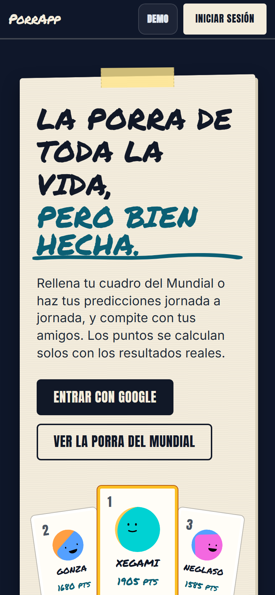
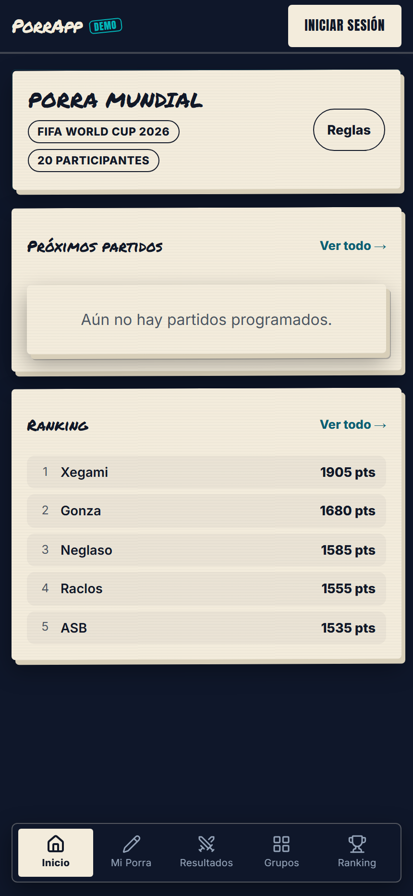
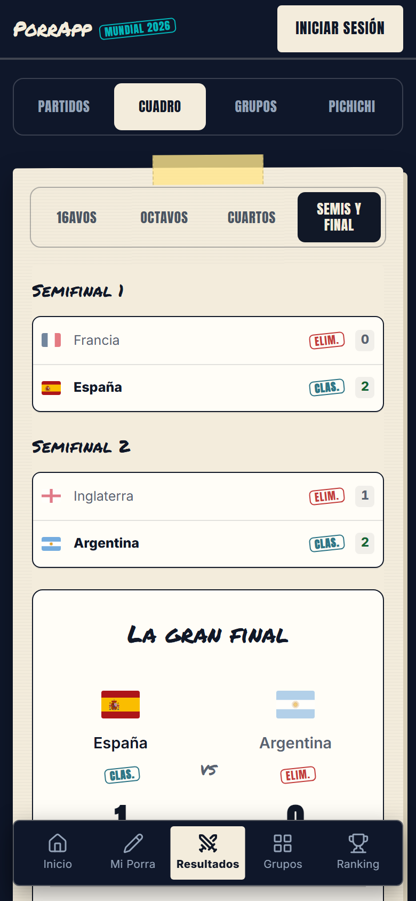
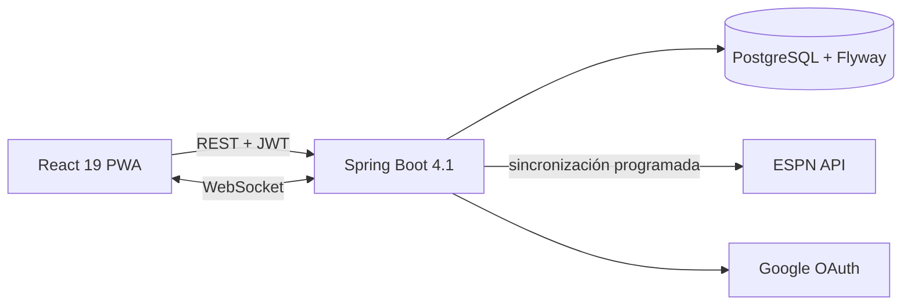

<div align="center">


# PorrApp

**Porras de fútbol con amigos: eliges el formato, los resultados llegan solos y la clasificación se mueve en directo.**

[](https://porra.raclos.es/demo)
[](https://github.com/RaclosDev/porrApp/actions/workflows/ci.yml)


</div>

> **Pruébala en 10 segundos:** abre la [demo](https://porra.raclos.es/demo) desde el móvil. Es una liga real de 21 personas del Mundial 2026 en modo de solo lectura, sin registro.

## 📱 La app

<table>
  <tr>
    <td align="center" width="33%"><br><sub><b>Portada</b> · entrar con Google o ver la demo</sub></td>
    <td align="center" width="33%"><br><sub><b>Inicio</b> · últimos resultados sincronizados</sub></td>
    <td align="center" width="33%"><br><sub><b>Ranking</b> · podio y desglose por fase</sub></td>
  </tr>
  <tr>
    <td align="center"><br><sub><b>Mi porra</b> · cuadro completo y puntos por acierto</sub></td>
    <td align="center"><br><sub><b>Resultados</b> · cuadro oficial en vivo</sub></td>
    <td align="center"><br><sub><b>Grupos</b> · tablas con desempates FIFA</sub></td>
  </tr>
</table>

## ✨ Qué hace

- **Ligas privadas** con código de invitación, control de pagos y normas propias.
- **Tres formatos de porra:** cuadro completo (grupos y eliminatorias), solo eliminatorias, o jornada a jornada con 1X2 y marcador exacto.
- **Resultados automáticos:** los partidos se sincronizan desde ESPN y la puntuación se recalcula sola en el backend. Las competiciones personalizadas admiten resultados manuales.
- **En directo:** cada gol llega por WebSocket y actualiza clasificación, cuadro y jornadas sin recargar.
- **Cuadro oficial calculado:** cruces resueltos con los mejores terceros y desempates según el artículo 13 del reglamento del Mundial 2026.
- **Estadísticas:** favoritos de la liga, buscador por equipo, evolución de la clasificación y reparto de pronósticos por partido.
- **PWA instalable**, con inicio de sesión de Google y sesiones seguras.

## 🧠 Lo interesante por dentro

| | |
| --- | --- |
| **Dominio extensible** | La puntuación sigue el patrón *Strategy* (`ScoringStrategy`). Un torneo nuevo no toca el resto del dominio, y cada liga ajusta sus propios valores. |
| **Proveedores intercambiables** | `SportsDataProvider` aísla la fuente de datos; ESPN es solo una implementación. Un *circuit breaker* de Resilience4j protege la app cuando ESPN falla. |
| **Tiempo real fiable** | WebSockets para los marcadores y ShedLock para que la sincronización programada corra una sola vez aunque haya varias instancias. |
| **Seguridad** | Access token JWT de 15 minutos en memoria y refresh token rotatorio en cookie `HttpOnly`. Validación de OAuth de Google en el backend. |
| **Contrato tipado** | Los controladores devuelven DTOs/records, y el frontend tiene un único cliente tipado (`services/api.ts`) con esos contratos. |
| **Lógica testeable** | El cuadro oficial, la normalización de pronósticos y la evolución de la clasificación son funciones puras con tests propios. |
| **Observabilidad** | Spring Boot Actuator con métricas Prometheus, caché Caffeine y documentación OpenAPI/Swagger. |



## ✅ Calidad

- **Más de 1.000 tests automatizados:** unos 470 de frontend (Vitest y Testing Library) y unos 600 de backend (JUnit 5, Mockito y **Testcontainers** con PostgreSQL real).
- **E2E con Playwright** sobre la build de producción, en escritorio y móvil.
- **Cobertura mínima obligatoria en CI:** 80 % de líneas en backend (JaCoCo) y umbrales propios en frontend.
- **TypeScript `strict`**, ESLint, Prettier y hooks de pre-commit.
- **CI/CD en GitHub Actions** que solo ejecuta los jobs de la parte modificada. Railway despliega únicamente si la CI pasa.

## 🛠️ Stack

| Capa | Tecnologías |
| --- | --- |
| Frontend | React 19, TypeScript, Vite, TanStack Query, Zustand, Tailwind CSS 4, PWA |
| Backend | Java 21, Spring Boot 4.1, Spring Security, Spring Data JPA, WebSockets, Resilience4j, ShedLock |
| Datos | PostgreSQL, migraciones Flyway, caché Caffeine |
| Calidad | Vitest, Testing Library, Playwright, JUnit 5, Mockito, Testcontainers, JaCoCo |
| Infraestructura | Docker multi-etapa, GitHub Actions, Railway |

## 🚀 Ejecutarla en local

```bash
cp .env.example .env   # rellena JWT_SECRET y GOOGLE_CLIENT_ID
docker compose up --build -d
```

La app queda en [localhost:8080](http://localhost:8080). La guía completa (desarrollo sin Docker, variables de entorno, tests y CI) está en [docs/development.md](docs/development.md), y la arquitectura del backend en [docs/architecture.md](docs/architecture.md).

## 👤 Autor

**Carlos Sanz Tomero**: desarrollador full-stack Java y React.

[](https://www.linkedin.com/in/carlos-sanz-tomero/)
[](https://raclosdev.github.io)

Código publicado bajo [licencia MIT](LICENSE).
